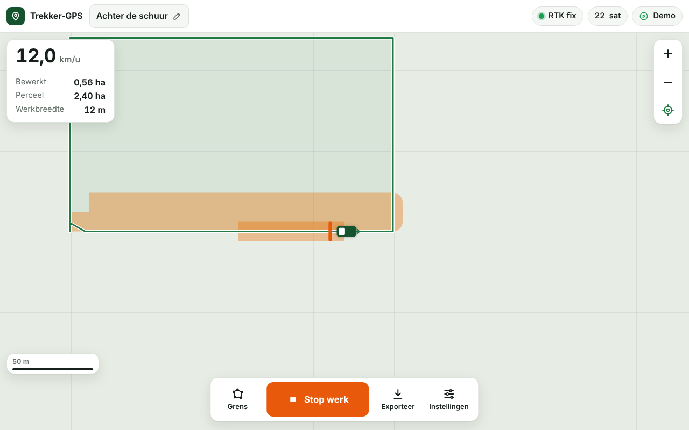
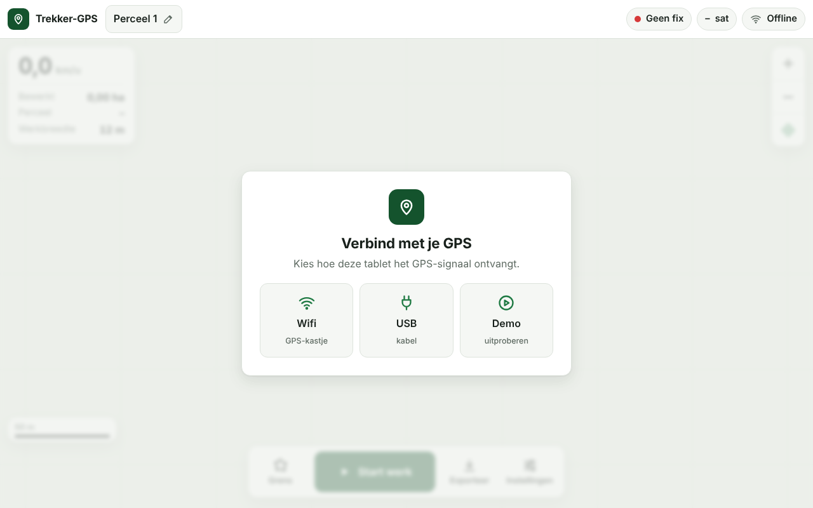
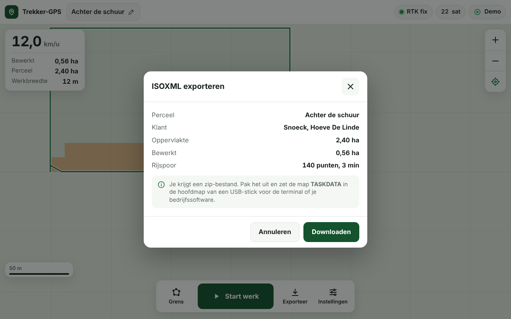

# Trekker-GPS voor tablet en Amatron 3

Een zelfbouw-GPS voor de tractor. Eén GPS-ontvanger voedt twee schermen tegelijk:

- **De tablet** toont de eigen Trekker-GPS app via wifi. Die tekent de kaart, neemt perceelgrenzen op en exporteert ISOXML.
- **De Amazone Amatron 3** krijgt GGA, VTG en GSA via RS232 aan 19200 baud, zoals de handleiding vraagt.

```
                 dual-band antenne (op het dak)
                          │
                 ┌────────┴────────┐
                 │  Quectel LC29H  │  GPS-module
                 └────────┬────────┘
                          │ 3,3V seriëel, 115200 baud
                 ┌────────┴────────┐
 tablet ◄─wifi───┤      ESP32      ├──wifi──► NTRIP (RTK-correcties, optioneel)
 (app in browser)│                 │
                 └────────┬────────┘
                          │ 3,3V
                 ┌────────┴────────┐
                 │     MAX3232     │  zet 3,3V om naar echte RS232
                 └────────┬────────┘
                          │ RS232, 19200 baud, GGA + VTG + GSA aan 5 Hz
                     Amatron 3
```

## Eerst lezen: welke GPS-module?

De Amatron 3 wil **minstens 5 posities per seconde**. Niet elke LC29H-variant kan dat.

| Variant | Nauwkeurigheid | Snelheid | Geschikt? |
|---|---|---|---|
| LC29H(BS) | basisstation | n.v.t. | **Nee.** Dient om zelf een RTK-basisstation te bouwen. |
| LC29H(DA) | cm met RTK | RTK maar 1 Hz | **Liever niet.** Te traag voor de Amatron in RTK. |
| LC29H(AA) | ongeveer 1 m met SBAS/EGNOS | tot 10 Hz | **Ja**, goedkoopste optie. |
| LC29H(EA) | cm met RTK | RTK tot 10 Hz | **Beste LC29H-keuze**, als je hem vindt. |
| u-blox ZED-F9P | cm met RTK | 10 Hz+ | **Ja**, de standaard bij AgOpenGPS, maar duurder. |

De firmware werkt met elke ontvanger die NMEA uitstuurt. Alleen het automatische instellen bij het opstarten is specifiek voor de LC29H. Zet `GNSS_SEND_CONFIG` op 0 bij een andere ontvanger.

## Onderdelen

| Onderdeel | Opmerking |
|---|---|
| GPS-module LC29H(AA) of (EA) | bv. de Waveshare LC29H GPS/RTK HAT |
| Dual-band L1/L5 actieve antenne | met magneetvoet, midden op het cabinedak |
| ESP32 DevKit (ESP32-WROOM-32) | gewone ESP32, **geen** S3/C3, anders werkt Bluetooth niet |
| MAX3232-module met Sub-D 9 | RS232-omzetter, werkt op 3,3V |
| DC-DC omvormer 12V naar 5V, 2A | voor auto/tractor, met zekering ervoor |
| Kabel naar de Amatron 3 | seriële aansluiting van de Amatron, Sub-D 9 |
| Behuizing, kabelwartels | stof en trillingen in de cabine |

## Aansluiten

**Belangrijk:** de Amatron werkt met echte RS232, dat is ±5 tot ±12V. Sluit hem nooit rechtstreeks op de ESP32 aan, altijd via de MAX3232.

### Voeding

```
tractor 12V ── zekering 2A ── DC-DC 12V→5V ──┬── ESP32 pin 5V/VIN
                                             └── HAT headerpin 2 (5V)
tractor massa ───────────────────────────────── GND van alles samen
```

### GPS-module (Waveshare HAT) naar ESP32

Zet de schakelaar op de HAT op **B** (Pi ↔ LC29H). De pinnummers zijn die van de Raspberry Pi-header. Controleer ze met de opdruk op het bordje.

| HAT-headerpin | Functie | ESP32 |
|---|---|---|
| 2 | 5V | 5V |
| 6 | GND | GND |
| 10 | module TX | GPIO16 |
| 8 | module RX | GPIO17 |

De ESP32 en de LC29H werken allebei op 3,3V. Een levelshifter is dus niet nodig, in tegenstelling tot bij een Arduino Uno.

### ESP32 naar MAX3232 naar Amatron 3

| ESP32 | MAX3232-module | Amatron 3 Sub-D 9 |
|---|---|---|
| 3V3 | VCC | |
| GND | GND | pin 5 (GND) |
| GPIO26 | TXD / T1IN | uit T1OUT naar Amatron RX |
| GPIO27 | RXD / R1OUT | niet nodig |

Bij een standaard RS232-apparaat is pin 2 de ontvangst (RX) en pin 3 de zending (TX). Komt er niets aan, wissel dan pin 2 en 3, of gebruik een null-modemkabel.

**Tip om RX en TX te vinden:** meet met een multimeter tussen pin 5 en pin 2 en 3 terwijl de Amatron aanstaat. De pin met ongeveer -5 tot -12V is de TX van de Amatron. De andere is RX, en daar moet het GPS-signaal naartoe.

## Amatron 3 instellen

Volgens de handleiding MG4038 verwacht de Amatron 3:

| Instelling | Waarde |
|---|---|
| Baudrate | 19200 |
| Data | 8 bits, geen pariteit, 1 stopbit |
| Zinnen | GGA, VTG en GSA |
| Frequentie | 5 Hz |

1. Schakel de lightbar uit in de Setup van het terminal, onder Program Manager.
2. Stel de baudrate in op 19200 in het menu GPS-diagnose.
3. Herstart de Amatron.
4. Controleer in het menu GPS-diagnose of er een positie binnenkomt.
5. Vul de positie van de antenne op de tractor in bij de machinegegevens.

Oudere Amatron-software verwacht soms `$GPGGA` in plaats van `$GNGGA`. De firmware zet dat standaard om. Dat stel je in met `AMATRON_TALKER_GP` in `config.h`.

## De Trekker-GPS app



De app zit in het geheugen van de ESP32. Er is niets te installeren, en ze werkt op elke tablet met een browser, Windows of Android.

1. Zet het GPS-kastje aan.
2. Verbind de tablet met het wifinetwerk **Trekker-GPS**. Het standaardwachtwoord is `trekker123`. Verander het in `config.h`.
3. Open `http://192.168.4.1` in Chrome. De app verbindt automatisch.
4. Voeg de pagina toe aan het startscherm, dan opent ze als een gewone app.

**Werken met de app:**

- **Instellingen:** naam van het perceel, klant, bedrijf en werkbreedte.
- **Grens opnemen:** rij rond het perceel en druk op "Grens stoppen". De app toont de oppervlakte.
- **Werk AAN/UIT:** tekent de bewerkte stroken in de werkbreedte en houdt het rijspoor bij. Overlap wordt donkerder.
- **ISOXML exporteren:** maakt een zip met de map `TASKDATA`. Pak uit en zet de map op de USB-stick voor de Amatron of je bedrijfssoftware.
- **Demo:** een gesimuleerde tractor, om de app zonder GPS uit te proberen.
- **Weergave:** dag, nacht of automatisch, voor werk in de zon of 's avonds.

| Verbinden | Exporteren |
|---|---|
|  |  |

Alles wordt bewaard in de tablet, ook als de pagina herlaadt. Exporteer toch na elk perceel. Gewiste browsergegevens zijn anders weg.

De app werkt ook zonder kastje:

- **Demo:** open `app/dist/index.html` op een computer en kies Demo bij Instellingen.
- **USB-kabel:** in Chrome of Edge op een Windows-tablet of computer. Kies dan "USB-kabel" bij Instellingen.

Gebruik je liever een andere app, zoals AgOpenGPS? Zet dan `TABLET_BT_ENABLED` op 1 of gebruik de USB-kabel. Die kanalen sturen dezelfde NMEA-zinnen.

## Productnaam en vermelding

De productnaam, versie, bedrijfsnaam en vermeldingen staan samen in `app/src/brand.js`. Pas ze daar aan en bouw de app opnieuw. Ze verschijnen in de bovenbalk, bij Instellingen onder "Over" en in de ISOXML-bestanden.

Deze app en firmware zijn ontwikkeld met hulp van Claude, een AI-assistent van Anthropic.

## Op weg naar verkoop

Voor je het product verkoopt, moeten deze punten nog geregeld worden:

- **CE-markering:** een toestel met wifi valt onder de Europese richtlijn voor radioapparatuur. Sinds augustus 2025 horen daar ook cyberbeveiligingseisen bij.
- **Wachtwoord per toestel:** een vast standaardwachtwoord zoals `trekker123` mag dan niet meer. Elk kastje heeft een eigen wachtwoord nodig, bijvoorbeeld op een sticker.
- **Licenties:** de ESP32-software en de webserverbibliotheken gebruiken open-sourcelicenties zoals de LGPL. Laat nakijken wat dat betekent voor de verkoop van de firmware.
- **Eigen licentie:** kies onder welke voorwaarden jullie eigen code verkocht of gedeeld wordt.
- **Compatibiliteit:** test de ISOXML-export met de Amatron 3 en met de bedrijfssoftware van jullie klanten.
- **Behuizing:** stof- en waterdicht, bestand tegen trillingen, met een stevige aansluiting op 12V.

## ISOXML-bestanden

ISOXML-taakbestanden heten `TASKDATA.XML` en volgen de norm ISO 11783-10. Het GPS-kastje maakt zelf geen bestanden. Het levert alleen de positie. Er zijn twee plaatsen waar de ISOXML-bestanden gemaakt kunnen worden.

### Op de Amatron 3, de eenvoudigste weg

De Amatron 3 heeft standaard een Task Controller voor taakbeheer in ISO-XML. Zodra hij GPS krijgt van dit kastje, kan hij taken registreren en taakkaarten afwerken.

1. Maak een taak, perceel of taakkaart in je bedrijfssoftware en zet de map `TASKDATA` op een USB-stick.
2. Importeer de taak op de Amatron 3 en start ze.
3. Rijd op het perceel. De Amatron registreert de bewerkte oppervlakte en hoeveelheden met de GPS-positie.
4. Exporteer de taak terug naar de USB-stick en lees ze in je bedrijfssoftware in.

Optionele licenties breiden dit uit. GPS-Switch zorgt voor automatische sectieschakeling. GPS-Maps leest taakkaarten in shapefile-formaat.

### Met de Trekker-GPS app

De app maakt een ISOXML-taak in versie 3. Versie 3 is de versie die oudere terminals zoals de Amatron 3 lezen. De export bevat:

| Bestand | Inhoud |
|---|---|
| `TASKDATA.XML` | klant, bedrijf, perceel met grens en de taak |
| `TLG00001.XML` en `TLG00001.BIN` | het rijspoor met tijd, positie en GPS-kwaliteit, één punt per seconde |

Machinegegevens zoals hoeveelheden of de werkstand zitten er nog niet in. Daarvoor is een apparaatbeschrijving nodig, en dat is een volgende stap.

## RTK-correcties

Voor centimeternauwkeurigheid heb je een LC29H(DA/EA) of ZED-F9P nodig, plus correcties van een basisstation via internet. Dat heet NTRIP. Er zijn twee manieren:

1. **Via de tablet:** de NTRIP-client in AgIO stuurt de correcties over USB of Bluetooth terug. De ESP32 geeft ze door aan de GPS. Dit staat standaard aan.
2. **Via wifi op de ESP32:** zet `NTRIP_ENABLED` op 1 en vul de gegevens van je gsm-hotspot en caster in `config.h` in.

Gebruik er maar één van tegelijk.

Mogelijke correctiediensten:

- **FLEPOS:** RTK-netwerk van de Vlaamse overheid, voor Vlaanderen. Registratie nodig.
- **Centipede:** gratis netwerk van vrijwilligers, met basisstations in België en Nederland. Kies een mountpoint dicht bij je perceel.
- **06-GPS:** betalende dienst in Nederland.

## Firmware uploaden

1. Installeer de Arduino IDE en het bordpakket "esp32" van Espressif.
2. Open `firmware/trekker_gps/trekker_gps.ino`.
3. Pas `firmware/trekker_gps/config.h` aan.
4. Kies het bord "ESP32 Dev Module" en de juiste poort.
5. Installeer via Bibliotheken beheren: **ESPAsyncWebServer** en **AsyncTCP**, allebei van ESP32Async.
6. Klik op uploaden.

Zonder tablet kan je testen met `DEBUG_OUTPUT` op 1. Open de seriële monitor aan 115200 baud. Elke 5 seconden verschijnt dan een regel met het aantal posities per seconde, de fix-kwaliteit en hoeveel zinnen naar de Amatron gingen. Zet de optie terug op 0 voor gebruik met de tablet.

De led op de ESP32 knippert bij elke positie en brandt continu bij een RTK-fix.

## Voor ontwikkelaars

De app staat in `app/src`: `brand.js` voor naam en versie, `app.js` voor het scherm en losse modules voor NMEA, geometrie, ISOXML en ZIP. Na een wijziging bouw je ze opnieuw. Dat maakt `app/dist/index.html` en `firmware/trekker_gps/web_app.h`:

```
python3 tools/build_web.py
```

Tests:

```
g++ -std=c++17 -Wall -Wextra -I firmware/trekker_gps test/test_nmea.cpp -o test_nmea && ./test_nmea
node --test test/app.test.js
NODE_PATH=$(npm root -g) node test/e2e_demo.cjs
```

De laatste test rijdt met de demo-tractor door de app in een echte browser en controleert de ISOXML-export. Daarvoor is Playwright nodig.

## Nog na te kijken op de echte hardware

- De pinnen van de seriële aansluiting op jouw Amatron 3-kabel.
- Of je Amatron-versie `$GNGGA` aanvaardt of `$GPGGA` nodig heeft.
- Of de Amatron 3 of je bedrijfssoftware de ISOXML-export van de app zonder fouten inleest.
- De LC29H-instelcommando's (`PAIR050` en `PAIR062`). Ze volgen de Quectel-documentatie, maar zijn nog niet op een echte module getest.
